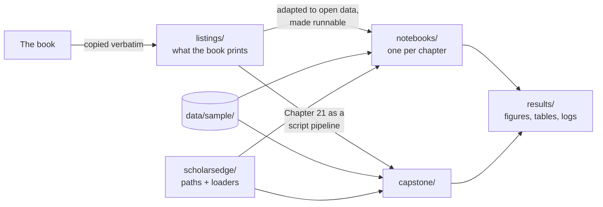

# Understanding this codebase

A short guide to how the repository is organised and why. For the research ideas behind
the code, see the book. This file only explains where things are and how they connect.

## The big picture: three layers of the same code



| Layer | Purpose | Edit it? |
|---|---|---|
| `listings/` | An exact copy of every listing in the book, so you can match a page to a file. Many need data or credentials you don't have yet. | No. It is the reference. |
| `notebooks/` | The same code with explanations, running on the sample data. **This is where you learn.** | Yes. Experiment freely. |
| `capstone/` | Chapter 21 as plain `.py` scripts, the way a real project is organised (Chapter 12). | Yes. Use it as a template for your own study. |

Keeping all three means the book stays the source of truth, and runnable code never
quietly drifts away from what readers see in print.

## Folder by folder

```
scholars-edge-code/
├── notebooks/            runnable chapter notebooks (00_setup_check first)
├── capstone/
│   ├── run_all.sh        experiments -> statistics -> figures, one command
│   └── src/              data.py, models.py, privacy.py, run_experiments.py, analyze.py, make_figures.py
├── listings/             79 verbatim listings, by chapter; INDEX.md maps each to its book section
├── scholarsedge/
│   └── datasets.py       ROOT/SAMPLE/RESULTS paths + load_nsl_kdd(), load_arxiv_sample(), ...
├── data/
│   ├── sample/           committed open datasets (about 12 MB)
│   ├── raw/              your downloads, e.g. CICIDS2017 (git-ignored)
│   └── README.md         sources, licences, citations
├── scripts/
│   ├── build_sample_data.py   re-download sources and rebuild data/sample/
│   └── make_model_results.py  the real model runs behind model_results.csv
├── results/              everything the code writes (git-ignored)
├── requirements.txt      core packages; requirements-optional.txt for Opacus and Google Cloud
├── Dockerfile            the reproducible environment from Chapter 12
└── CITATION.cff, LICENSE
```

## How a notebook is put together

Every notebook follows the same pattern:

1. **A setup cell** finds the repository root and imports the shared paths, so the notebook
   works whether Jupyter was started in the repo root or in `notebooks/`:
   ```python
   from scholarsedge.datasets import ROOT, SAMPLE, RESULTS, FIGURES, TABLES
   ```
2. **Book code, in book order.** A Markdown cell before each listing names the book section.
   Where the book reads a file from its running example (for instance `survey_responses.csv`),
   the notebook reads the open stand-in instead. The mapping table is in `data/README.md`.
3. **Outputs go to `results/`**: figures to `results/figures/`, tables to `results/tables/`.

Two switches keep notebooks runnable anywhere:

| Switch | Meaning |
|---|---|
| `ONLINE` | Set automatically. Cells that call arXiv, Crossref or doi.org run only with internet access; otherwise they print a message or use an offline fallback. |
| `RUN_GCP = False` | Google Cloud cells (Chapters 8 and 11) run only after you set this to `True` and add your project ID. They cost money, so they are never on by default. |

## How the capstone fits together

```
data.py         load_dataset("nsl_kdd" | "cicids2017")  -> clean DataFrame with y, client_group
                prepare_split(df, seed)                  -> scaled train/test + list of clients
models.py       local_train (SGD / DP-SGD), fedavg       -> weight vector w
privacy.py      noise_for_epsilon(eps, n, ...)           -> sigma  (Opacus, or NumPy fallback)
                membership_inference_auc(...)            -> how much the model leaks
run_experiments seeds x {centralized LR, RF, FedAvg, FedAvg+DP at each eps} -> capstone_runs.csv
analyze.py      mean/SD summary + TOST equivalence tests -> summary.csv, equivalence_tests.csv
make_figures.py                                          -> capstone_privacy_tradeoff.pdf/png
```

The dataset switch is the only place NSL-KDD and CICIDS2017 differ. Everything downstream
sees the same columns. See `capstone/README.md` for flags and expected results.

## Common tasks

| I want to… | Do this |
|---|---|
| Check my installation | Run `notebooks/00_setup_check.ipynb` |
| Find the code from a page of the book | `listings/INDEX.md` lists every listing with its caption and section |
| Use my own data | Put it in `data/raw/`, then change the `pd.read_csv(...)` line in the notebook. The rest of the code is generic. |
| Run the capstone on the real CICIDS2017 | Follow `data/README.md`, then `bash capstone/run_all.sh --dataset cicids2017` |
| Rebuild the sample data | `python scripts/build_sample_data.py` |
| Use the exact Opacus accountant | `pip install opacus`. `privacy.py` switches to it automatically. |
| Reproduce in a container | `docker build -t scholars-edge . && docker run --rm -v "$(pwd)/results:/app/results" scholars-edge` |

## Design choices worth knowing

- **Faithful first.** Notebook code differs from the book only where it must: file paths,
  dataset column names, or a missing variable the book assumes exists (such as
  `pred_a`/`pred_b` for McNemar's test). Each change is commented.
- **Real data, labelled honestly.** Every sample is a real open dataset, or a result computed
  from one. The only exception is the Chapter 9 transcripts: no open coded-interview dataset
  exists, so those are short illustrative texts and are marked as such.
- **No heavy dependencies by default.** PyTorch (via Opacus) and the Google Cloud SDKs are
  optional. The core install is the scientific Python stack.
