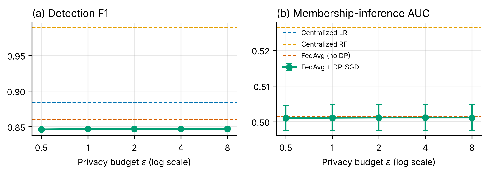

# The Scholar's Edge: companion code

Code, notebooks and sample data for **_The Scholar's Edge: Mastering Research, Data and
AI in the Cloud Era_** by Roise Uddin.

Every code listing in the book is here, and every Python listing can be run on real, open
data that ships with the repository. You can be running the first experiment in a few minutes.

<p align="center"></p>

## Quick start

```bash
git clone https://github.com/yourname/scholars-edge-code.git
cd scholars-edge-code
python -m venv .venv && source .venv/bin/activate     # Windows: .venv\Scripts\activate
pip install -r requirements.txt
jupyter lab notebooks/00_setup_check.ipynb
```

To regenerate the capstone results from the command line instead:

```bash
bash capstone/run_all.sh          # under a minute on a laptop
```

## What's inside

| Folder | What it is |
|---|---|
| [`notebooks/`](notebooks/) | **Start here.** One runnable notebook per chapter that has code |
| [`capstone/`](capstone/) | The Chapter 21 research project as a proper script pipeline |
| [`listings/`](listings/INDEX.md) | All 79 book listings, verbatim: Python, shell, SQL, LaTeX, BibTeX, Docker, templates |
| [`data/`](data/README.md) | Open sample datasets, with sources and licences |
| [`scholarsedge/`](scholarsedge/) | A small helper module: data paths and loaders |
| [`scripts/`](scripts/) | Rebuild the sample data from its original sources |

For how these pieces fit together, read **[CODEBASE.md](CODEBASE.md)**.

## Notebooks

| Notebook | Book chapter | Runs on |
|---|---|---|
| `00_setup_check` | Appendix A: Setup | – |
| `ch03_research_trends` | 3: Choosing a topic | arXiv API (online) |
| `ch04_literature_review` | 4: Literature review: dedup, screening sheet, LDA | arXiv abstracts sample |
| `ch05_reliability` | 5: Methodology: Cronbach's alpha | Big Five Inventory (2,800 respondents) |
| `ch07_statistics` | 7: Statistics: CIs, power, t-tests, regression, McNemar | sleep study, Prestige, NSL-KDD results |
| `ch08_data_collection_and_cleaning` | 8: Data collection and cleaning | arXiv API / sample, NSL-KDD |
| `ch09_qualitative` | 9: Qualitative analysis: co-occurrence, kappa, quote checks | illustrative transcripts |
| `ch10_analytics_and_figures` | 10: EDA, publication figures, LaTeX tables | NSL-KDD |
| `ch11_google_cloud` | 11: BigQuery, Cloud Storage, Vertex AI, Gemini | your GCP project (off by default) |
| `ch12_reproducibility` | 12: Seeds and provenance logging | NSL-KDD |
| `ch13_ai_verification` | 13: Reference checking, leakage, AI-usage log | NSL-KDD, Crossref (online) |
| `ch14_citations` | 14: DOI → BibTeX, APA and IEEE formatting | Crossref (online, with offline fallback) |
| `ch21_capstone` | 21: Federated learning with differential privacy | NSL-KDD (or CICIDS2017) |

Chapters 1, 6, 15–20 and 22 have no runnable Python. Their LaTeX, template and shell
listings are in `listings/`.

The notebooks are saved with outputs from an offline run, so cells that call a web API show
"Offline". Run them yourself to get live results.

## Data

The book's running example is federated intrusion detection on **CICIDS2017** (2.8M
flows; manual download). So that everything runs immediately, the repo ships the open
**NSL-KDD** dataset from the same institute, plus small open datasets for the statistics
and literature chapters. Sources, licences and the swap from CICIDS2017 to NSL-KDD are
documented in [data/README.md](data/README.md).

## Citing

See [CITATION.cff](CITATION.cff). Code is MIT-licensed ([LICENSE](LICENSE)). Datasets
keep their own licences.
